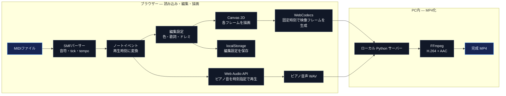
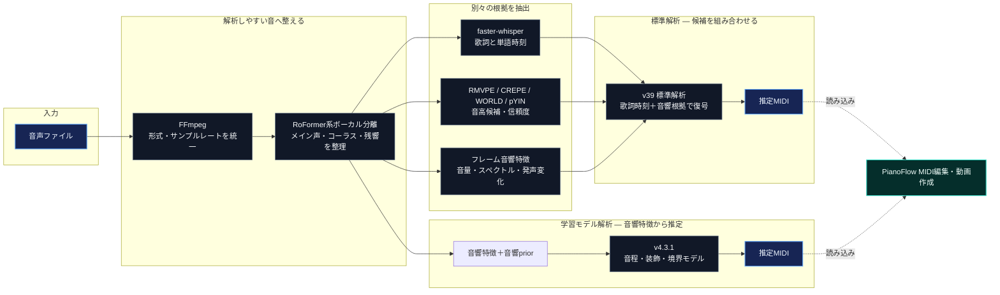

# PianoFlow — MIDIから、ピアノ動画へ

## 概要

PianoFlowは、MIDI音源を入力し演奏を見やすいピアノ動画にし、色や歌詞を画面上で編集できるものです。音声からメロディMIDIを作り、自動でピアノ動画に変換するAI解析機能も搭載されています。

## 操作デモ

**操作デモ:** [GitHub Pages版を開く](https://yamadatarou11.github.io/pianoflow/demo/?sample=1)

## 操作動画

https://github.com/user-attachments/assets/21d18149-cc3b-440e-841d-f3dacbfa32a5

[操作ガイド動画（MP4）](assets/PianoFlow_使い方_ゆっくり操作ガイド.mp4)

動画では、MIDIの読み込みと再生、バーの色変更、歌詞の割り当て、発光タイミングの調整、動画保存を紹介しています。

## 主な機能

- MIDIファイルの読み込みとピアノロール再生
- バー・鍵盤の色、ドレミ表示などの編集
- 曲名・歌詞の表示と、歌詞のバーへの割り当て
- 文字単位の歌詞発光タイミングの調整
- 編集設定の保存と、音声付きピアノ動画の出力
- 音声からのボーカル分離、歌詞文字起こし、メロディMIDI推定

## 技術選定・アーキテクチャ

### MIDIから動画へ

MIDIの音符イベントを読み込んだ後、編集画面・ピアノ音・動画を同じ再生時刻から作ります。音符を音声から再推定しないため、入力MIDIの音高やタイミングをそのまま映像へ反映できます。



| 技術 | 採用理由 |
| --- | --- |
| HTML・CSS・JavaScript | MIDIの読み込み、歌詞入力、再生、見た目の編集を一画面でつなぐため。編集操作のたびに別ツールへ書き出す手間をなくし、プレビューへすぐ反映できます。 |
| 独自のStandard MIDI File（SMF）パーサー | MIDIは音高だけでなくtickとテンポ情報で演奏時刻を表します。それらをノートイベントへ変換して保持し、再生・表示・書き出しの間でタイミングがずれにくい土台にするためです。 |
| Canvas 2D | ピアノロールは平面上の図形描画が中心です。フレームごとにノーツ、鍵盤、文字を直接描けるため、必要な表現を保ちながら3D/WebGLの描画基盤を増やさずに済みます。 |
| Web Audio API＋Salamander Grand Pianoサンプル | MIDIのノート時刻に合わせて発音をスケジュールでき、単純な電子発振ではなく録音されたピアノ音をプレビューと動画音声に使えるためです。 |
| WebCodecs（固定fps） | 実時間の画面録画に依存せず、各フレームへ明示的な時刻を付けて映像化するためです。再生負荷によるフレーム間隔の揺れを避けやすくし、非対応時は固定30fpsの互換経路へ切り替えます。 |
| ローカルPythonサーバー＋FFmpeg | ブラウザーで生成した映像とピアノ音声をPC内で結合し、H.264/AACのMP4として検証・保存するためです。変換を外部サービスに依存せず、手元の音源をアップロードしない構成にできます。 |
| `localStorage` | 編集設定は利用者ごと・端末ごとに保持すればよく、サーバーやアカウントを介さず保存・復元できるためです。 |

### 音声からメロディMIDIへ

こちらはMIDI編集とは別の解析経路です。ボーカルを取り出し、歌詞の時刻を大枠の手掛かりにしながら複数の音高候補と音響特徴を組み合わせ、最後にノートイベントとしてMIDIへ書き出します。



| 技術 | 採用理由 |
| --- | --- |
| `audio-separator`（RoFormer系） | 伴奏やコーラスが残った混合音から直接音高を取ると、別の声や楽器を主旋律と誤認しやすくなります。先にボーカルを分離し、さらにコーラス残差や残響を抑える段階を設けて、後段へ渡す信号を整理します。 |
| faster-whisper `large-v3-turbo` | 12曲規模の自前データだけで音声認識モデルを一から作るのではなく、多言語の事前学習済みモデルを使って歌詞候補を得るためです。単語時刻はフレーズの位置合わせに使い、日本語の音符境界そのものとは扱いません。Turboを選んだのは推論負荷とのバランスで、他モデルより高精度だと比較実証したという意味ではありません。 |
| RMVPE・CREPE・WORLD・pYIN | 単一の推定器に頼ると、その方式固有のオクターブ誤りや無声音への反応をそのまま採用する危険があります。異なる推定器から候補と信頼度を集め、後段で合意・音響的妥当性を確認する設計にします。 |
| 歌詞時刻＋音量・スペクトル・子音／母音特徴 | 歌詞時刻は「どの語・フレーズ付近か」を狭め、音響特徴は実際の発声開始、再発音、音高変化を確かめます。歌詞だけでは音符の細かな境界が決まらず、音響だけでは語の位置を見失いやすいため、両者を異なる役割で組み合わせます。 |
| 拡張時間畳み込み＋Transformer Encoder（PyTorch） | 1フレームの値だけで音程や境界を決めず、前後の変化も見て判定するためです。拡張Conv1Dで短い発声変化から長めの音列パターンまで捉え、Transformer Encoderで離れたフレームの関係も扱います。全区間を参照できるオフライン解析なので、未来側の文脈も利用できます。 |

どちらの解析経路で得たMIDIも、MIDI編集画面へ読み込んで再生・編集・動画化できます。AI解析と動画作成は別の処理ですが、MIDIファイルが両者をつなぐ受け渡し形式です。

v4.3.1は純粋なTCNではなく、**拡張時間畳み込み＋Transformer Encoderのハイブリッド**です。また、音響候補を初期予測として残し、ゼロ初期化したゲート付き残差で補正する構造です。これは既存候補を無条件に捨てず、学習モデルに誤りや不足を修正させるための設計です。時系列データとの適合性を理由に選んでおり、TCN単体や他方式より高精度だと比較実証したものではありません。

学習では12曲のボーカル音源と正解MIDIを使い、曲単位で学習・未学習曲評価を進めます。前段階の重みを引き継ぎつつ過去曲をリプレイし、評価で見つかった弱点を補う合成データを追加します。GPUは必須ではなく、対応する環境では学習モデルの推論にCUDAを利用できます。

## 動かし方

PianoFlowはGitHubからソースコードを取得し、自分のWindows PC上で実行します。音声AI解析を行うPCにはPython環境、必要なモデル、FFmpegを用意します。

動作環境はWindows、ChromeまたはEdge、FFmpegです。現在の構成では、アプリ側にPython 3.8系、音源分離・文字起こし・高品質音程推定側にPython 3.10系の仮想環境を使います。GPUは必須ではありません。MIDI編集はGPUなしで動き、AI解析もCPUで実行できますが、音声分離や認識には時間がかかります。

### MIDIの読み込み・編集・動画出力

1. リポジトリを取得します。

   ```powershell
   git clone https://github.com/yamadatarou11/pianoflow.git
   cd pianoflow
   ```

2. MIDIを読み込んで編集・試聴する場合は、`desktop/PianoFlow_v126.html`をChromeまたはEdgeで開きます。
3. Windowsランチャーから一連の機能を使う場合は、`desktop/PianoFlow Windows版.bat`を起動します。MP4出力にはローカルPython環境とFFmpegが必要です。

### 音声からのAI解析

1. Python 3.8系と3.10系でAI解析用の仮想環境を用意し、依存パッケージと音源分離・音程推定モデルを準備します。起動スクリプトは`desktop/.venv-pianoflow`と`desktop/.venv-pianoflow-hq`を参照します。これらの仮想環境自体はGitHubへ登録せず、PC上に構築します。
2. FFmpegをインストールし、コマンドから実行できるようにします。
3. CPUで解析する場合は`desktop/PianoFlow AI解析版.bat`を起動し、音声を選択して解析します。faster-whisperはCUDAが使えない環境ではCPUへ切り替わります。
4. GPU推論を使う場合は、対応するNVIDIA GPU・CUDA対応PyTorch環境とTCNの学習済み重みを準備して`desktop/PianoFlow AI GPU版.bat`を起動します。スクリプトがCUDA演算とモデルを事前確認し、確認に失敗した場合は解析を開始しません。

初回実行時は、音声認識や音源分離のモデルを取得するためインターネット接続が必要な場合があります。取得後の音声解析はローカルPCで行います。学習用音源、正解MIDI、解析キャッシュ、Python仮想環境は、サイズや権利の都合上、ソースコードと分けて管理します。TCN重みが必要なモードでは、`desktop/models/learning-v431/`に音程・装飾・境界の3つのチェックポイントを配置します。

## リポジトリ構成

```text
.
├── index.html               公開デモへの転送
├── demo/                    ブラウザーで操作できるデモ
├── desktop/                 Windowsローカル版・音声AI・学習コード・音源
├── assets/                  操作ガイド動画などの静的素材
├── docs/                    配布ファイルの説明
└── THIRD_PARTY_NOTICES.md    音源クレジット・ライセンス
```

ローカル版のHTML・Python・起動ファイルは `desktop/` にまとめています。ピアノMP3サンプル30個は `desktop/piano-samples/`、モデルの配置説明は `desktop/models/README.md` にあります。

埋め込みピアノ音源は `desktop/piano_samples_embedded.js` と `demo/piano_samples_embedded.js` に同じ内容を保持し、それぞれ単独で読み込めるようにしています。配布内容の詳細は[配布ファイル一覧](docs/UPLOAD_MANIFEST.md)を参照してください。

## 音源クレジット

ピアノ音源には、Alexander Holm作「Salamander Grand Piano V3」（CC BY 3.0）のTone.js配布サンプルを使用しています。サンプルはMP3およびオフライン再生用の埋め込みデータとして同梱し、再生時に音程を移調します。詳しい出典・表示は[第三者素材のクレジット](THIRD_PARTY_NOTICES.md)を参照してください。
